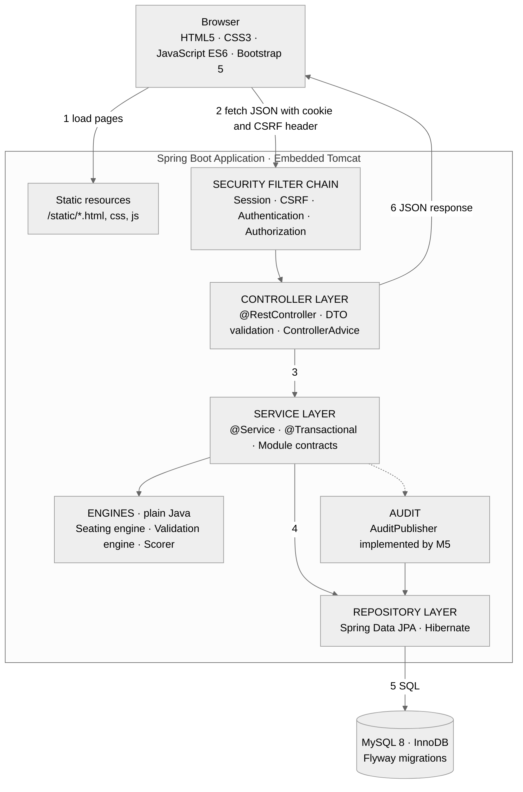
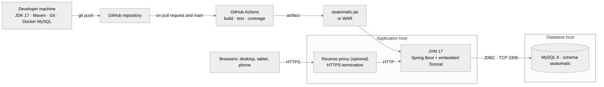
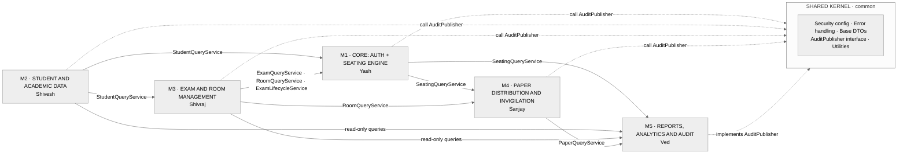
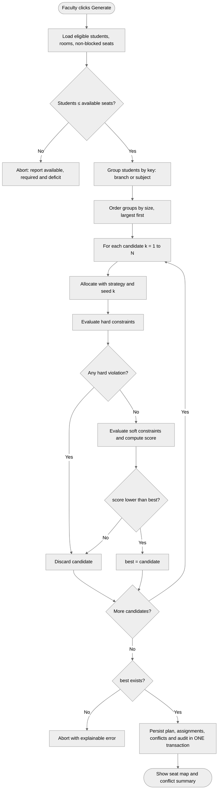
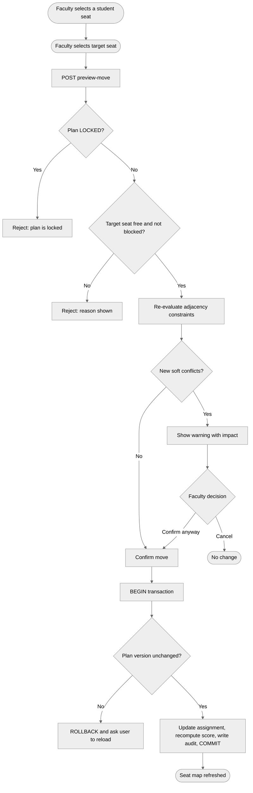
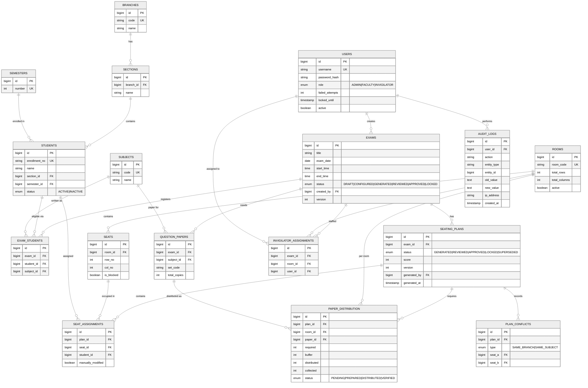

# Seat-o-Matic: Examination Seating and Paper Distribution Manager (Spring Boot Edition)

Oct 13, 2026 · @Yash Choudhary

Seat-o-Matic is a constraint-aware examination seating and question-paper platform built with Spring Boot, MySQL and an HTML/JavaScript front end, developed as five independent modules integrated into one product.

## 1. Project Administration

### 1.1 Document Control

| Item | Value |
| --- | --- |
| Document | Seat-o-Matic README, SRS and Design Pack |
| Version | 2.0 (Spring Boot edition) |
| Status | Draft for instructor review |
| Repository | [github.com/always-yash/Seat-o-Matic](https://github.com/always-yash/Seat-o-Matic) |
| Prepared by | Team Seat-o-Matic |
| Reviewed by | Er. Ram Babu Buri (Project Instructor) |
| Last updated | 13 Oct 2026 |

### 1.2 Project Details

| Field | Details |
| --- | --- |
| Project title | Seat-o-Matic: Automated Examination Seating Arrangement and Paper Distribution Manager |
| Category | Website Application (PBL), Java full-stack |
| Technology | Spring Boot, Spring MVC (REST), Spring Data JPA, Spring Security, MySQL 8, HTML5, CSS3, JavaScript (ES6), Bootstrap 5 |
| Institution | Arya College of Engineering and IT (ACEIT), Jaipur |
| Project instructor | Er. Ram Babu Buri |
| Duration | 12 weeks (84 days) plus a 6-day finalization buffer = 90-day log (07 Oct 2026 to 04 Jan 2027) |
| Team size | 5 members, one module each |

### 1.3 Team Members

| # | Name | Enrollment | Email | Mobile |
| --- | --- | --- | --- | --- |
| 1 | Yash Choudhary (Team Lead) | 24E1ARCSM30P187 | rundla.yash@gmail.com | 8502006448 |
| 2 | Ved Prakash Sharma | 24E1ARCSM40P180 | vedsharma6377@gmail.com | 7877145457 |
| 3 | Shivesh Surolia | 24E1ARCSM40P152 | shiveshsurolia@gmail.com | 6367340522 |
| 4 | Shivraj Singh | 24E1ARCSM40P153 | 99shivrajsrathore@gmail.com | 7877138838 |
| 5 | Sanjay Jangid | 24E1ARCSM30P146 | jangidssanjay@gmail.com | 8118875541 |

### 1.4 Module Ownership

| Module | Name | Owner | Core responsibility |
| --- | --- | --- | --- |
| M1 | Core: Authentication, Seating Engine and Integration | Yash Choudhary (Lead) | Architecture, shared kernel, login/sessions/RBAC, seating and validation engines, manual override, plan locking, integration and release |
| M2 | Student and Academic Data | Shivesh Surolia | Students, branches, sections, semesters, subjects, CSV import and validation, eligibility data |
| M3 | Examination and Room Management | Shivraj Singh | Examinations and lifecycle, rooms, seat grids, blocked seats, capacity, room-slot conflicts |
| M4 | Paper Distribution and Invigilation | Sanjay Jangid | Question-paper sets, room-wise requirements, distribution and collection tracking, invigilator view |
| M5 | Reports, Analytics and Audit | Ved Prakash Sharma | Reports, exports, conflict summary, analytics, audit trail, QA support |

### 1.5 Communication and Governance

| Practice | Detail |
| --- | --- |
| Daily | Individual log entry (hours, work description, status) in the reporting portal |
| Weekly | Team sync (30 min) on Monday; integration build every Friday; weekly report link added to the tracking sheet |
| Instructor checkpoints | End of Week 2 (SRS and design sign-off), Week 4 (walking skeleton), Week 8 (MVP review), Week 12 (final demo and viva) |
| Decision records | Technology and architecture decisions are recorded in Section 4 and docs/adr/ |
| Escalation | Module owner, then team lead, then instructor |

## 2. Abstract

Seat-o-Matic is a web-based Examination Seating Arrangement and Question Paper Distribution Manager built with Spring Boot, Spring Data JPA and MySQL 8 on the server and HTML5, CSS3 and JavaScript on the client. Every examination session forces an institution to answer the same question: which student sits in which seat of which room, so that students of the same branch or subject are kept apart, room capacities and blocked seats are respected, and the correct number of question papers reaches each room. Seat-o-Matic turns that recurring, error-prone chore into a controlled, explainable and auditable workflow.

In most colleges the work is still done in spreadsheets and word-processor tables, often in a few late hours before the paper. Capacity overflows and duplicate allocations surface only on the exam day. A late change ripples through the chart without anyone noticing. Nobody can later say who moved which student or why, and paper counts are estimated by hand. Seat-o-Matic replaces this with a single pipeline: student and academic data, examination set-up, room and seat configuration, automatic allocation, conflict analysis, faculty review and manual adjustment, validation, approval and locking, and finally paper-distribution tracking and printable reports.

The technical heart of the product is a constraint-aware seating engine written in plain Java, deliberately free of framework code so that it can be unit-tested in milliseconds. The engine models seating as a constraint-satisfaction and optimisation problem. Hard constraints can never be violated: a seat holds at most one student, a student occupies at most one seat, room capacity is never exceeded, only eligible students are placed, and blocked seats stay empty. Soft constraints are minimised with a weighted penalty score: students of the same branch or subject should not sit next to each other, and the distribution should stay balanced. Several candidate arrangements are generated with alternating and snake (zig-zag) traversal strategies and different seeds; a reusable validation engine evaluates each one, and the best valid candidate is chosen. When a perfect arrangement is mathematically impossible, for example 28 students of one branch and 2 of another in a 30-seat room, the system does not pretend otherwise. It reports the exact residual conflicts and the reason.

Faculty always stay in control. The seating workspace, a cinema-style seat map built in HTML, CSS and vanilla JavaScript, lets a faculty member select a student, preview the impact of moving or swapping them, confirm despite warnings if they choose, and see the plan re-scored instantly. Every change is validated by the same engine that generated the plan, written to an insert-only audit trail, and protected by optimistic locking so that two users cannot silently overwrite each other. Once the plan is validated and approved it is locked, and only an administrator can unlock it, which is itself audited.

Seat-o-Matic is engineered as a product, not as a single assignment. The code base is divided into five modules, each owned end to end by one team member: (M1) Core, covering authentication, architecture, the seating engine and system integration; (M2) Student and Academic Data; (M3) Examination and Room Management; (M4) Paper Distribution and Invigilation; and (M5) Reports, Analytics and Audit. Each module has its own controllers, services, repositories, entities, database migrations and front-end pages. Modules talk to each other only through small, published Java interfaces, and automated architecture tests fail the build if one module reaches into another's internals. Teams develop against stubs, integrate weekly, and converge on a Minimum Viable Product at the end of Week 8 and a hardened release at Week 12.

The platform covers the mandatory requirements of the Website Application Track: MVC separation, session management, server-side validation, password hashing, role-based access control and a responsive user interface. Spring MVC (built on the Servlet API and an embedded Tomcat) provides the controller layer, the HTML/JavaScript pages form the view, and the service and repository layers form the model. Spring Security protects every endpoint with BCrypt-hashed passwords, session fixation protection, CSRF tokens for the JavaScript client and method-level role checks. MySQL integrity is enforced with foreign keys, unique constraints, indexes and versioned Flyway migrations, and multi-step operations run inside transactions.

The outcome is a deployable Spring Boot application with a documented SRS, UML and ER design, a REST API specified with OpenAPI, a tested seating engine, and an end-to-end workflow that an examination cell could realistically adopt: generate, review, adjust, approve, lock, distribute papers, report and audit.

**Keywords:** Examination seating, constraint satisfaction, Spring Boot, REST API, MVC, JPA, MySQL, RBAC, audit trail, modular architecture, MVP.

## 3. Introduction

### 3.1 Problem Statement

Examination seating is prepared by hand in spreadsheets. The process breaks down when several branches, sections and subjects share one session; rooms differ in size and layout and some seats are blocked; students are added or moved late; question papers must be counted per room with a buffer; and faculty need a trustworthy record of every change.

| Pain point today | Consequence | Seat-o-Matic response |
| --- | --- | --- |
| Manual chart preparation | Hours of work, frequent clerical errors | One-click generation with scoring |
| No capacity check until the exam day | Students without seats | Pre-check with exact deficit report |
| Same-branch neighbours | Copying risk, complaints | Adjacency constraints, minimised and reported |
| Late changes | Silent breakage of the chart | Preview, validate, confirm, audit |
| Paper counts guessed | Shortage or waste | Per-room, per-subject counts plus buffer |
| No history | No accountability | Insert-only audit trail |
| Spreadsheet sharing | Conflicting versions | Single plan with optimistic locking and lock state |

### 3.2 Motivation

Examination integrity depends on correct seating, yet the tooling used is the least controlled part of the process. The project is also a vehicle to practise professional software engineering: requirements, modular design, contract-driven teamwork, security, testing and delivery.

### 3.3 Objectives

| ID | Objective | Measure of success |
| --- | --- | --- |
| O1 | Automate seat allocation under explicit hard and soft constraints | Zero hard violations in every persisted plan |
| O2 | Never report a perfect arrangement when one is impossible | Residual conflicts and reason shown for every infeasible case |
| O3 | Keep faculty in control with preview-validate-confirm overrides | Every manual change previewed and audited |
| O4 | Provide approval and locking | Locked plan rejects all edits except admin unlock |
| O5 | Track question-paper needs, distribution and collection | Per-room counts match seat assignments exactly |
| O6 | Give invigilators a restricted, room-scoped view | Cross-room access returns 403 |
| O7 | Keep a tamper-resistant audit trail | App DB user cannot update or delete audit rows |
| O8 | Deliver five independently built modules integrated by contracts | Architecture tests pass; weekly integration builds green |
| O9 | Reach a working MVP early and iterate | MVP tagged at end of Week 8 |
| O10 | Produce complete documentation | SRS, UML, ER, API, test report and user guide delivered |

### 3.4 Scope

| In scope | Out of scope (future work) |
| --- | --- |
| Students, branches, sections, semesters, subjects | Student-facing login and hall-ticket portal |
| Exams, eligibility, rooms, seat grids, blocked seats | Timetable generation |
| Automatic and manual seating, approval, locking | Online (on-screen) exam delivery |
| Paper sets, per-room requirements, distribution and collection tracking | Biometric or QR attendance |
| Reports, CSV/PDF export, analytics | Native mobile apps |
| RBAC for Admin, Faculty, Invigilator; audit trail | Multi-institution tenancy |

### 3.5 Assumptions and Constraints

| Type | Statement |
| --- | --- |
| Assumption | One institution, one academic session at a time |
| Assumption | Student master data is imported from college spreadsheets as CSV |
| Assumption | Rooms are rectangular grids (rows x columns) |
| Assumption | Faculty and invigilators have modern browsers (last two versions of Chrome, Edge, Firefox) |
| Constraint | Team of five, 12 weeks plus buffer, one module per member |
| Constraint | Java 17, MySQL 8, open-source libraries only |
| Constraint | Technology choices must be justified to the instructor (Section 4) |

### 3.6 Glossary

| Term | Meaning |
| --- | --- |
| Hard constraint | A rule that must never be violated in a persisted plan |
| Soft constraint | A preference minimised through a penalty score |
| Adjacency | Seats considered neighbours (left-right, four-way or eight-way) |
| Candidate | One generated arrangement before selection |
| Plan | The chosen arrangement and its assignments for an exam |
| Superseded | A plan replaced by a newer generation |
| Blocked seat | A physical seat that must stay empty |
| Buffer | Extra question papers printed per room |
| MVP | Minimum Viable Product: smallest integrated release that proves the whole workflow |
| Contract | A published Java interface through which one module uses another |
| DTO | Data Transfer Object used at API boundaries |
| RBAC | Role-Based Access Control |
| IDOR | Insecure Direct Object Reference |
| PRG | Post-Redirect-Get pattern |

## 4. Technology Decision Record

The original track brief named JSP-Servlet on Tomcat 9 with MySQL. The team upgraded the implementation to Spring Boot with an HTML/JavaScript front end. This section records why, what is kept from the brief, and what must be confirmed with the instructor.

### 4.1 ADR-001: Spring Boot instead of hand-written JSP-Servlet

| Aspect | Original brief | Implemented | Justification |
| --- | --- | --- | --- |
| Web layer | JSP + Servlets | Spring MVC controllers (DispatcherServlet is itself a Servlet) | Same Servlet API underneath; less boilerplate, better validation and testing support |
| Container | Tomcat 9 | Embedded Tomcat (WAR deployable to external Tomcat) | Same container family; simpler packaging |
| Persistence | JDBC | Spring Data JPA over JDBC (Hibernate) | Optimistic locking, derived queries, transaction management |
| View | JSP + JSTL | Static HTML + JavaScript calling REST APIs | Dynamic seat map and previews need client-side interaction |
| Security | Hand-written filters | Spring Security (filters, sessions, CSRF, BCrypt) | Battle-tested implementations of every mandatory item |
| Language | Java | Java 17 | Unchanged; engines remain plain Java |
| Database | MySQL | MySQL 8 | Unchanged |

Still satisfied from the brief: MVC, sessions, server-side validation, password hashing, role-based access, responsive UI, MySQL, Java.

Decision status: Accepted by team. Instructor confirmation (Er. Ram Babu Buri): \[ \] approved on \[date\]. If the instructor requires Tomcat 9 literally, pin Spring Boot 2.7.x (embedded Tomcat 9.0.x, javax.\* namespace) or build a WAR and deploy it to an external Tomcat 9; Spring Boot 3.x embeds Tomcat 10.1 and uses jakarta.\*.

### 4.2 Other Decisions

| ADR | Decision | Alternatives considered | Reason |
| --- | --- | --- | --- |
| 002 | REST API + static HTML/JS pages | Thymeleaf or JSP server rendering | Interactive seat map, live preview, clear API contract between modules and UI |
| 003 | Server-side session + CSRF cookie | JWT in local storage | Matches the track's session requirement; avoids token theft via XSS; simpler logout |
| 004 | Flyway versioned migrations, one set per module | Hibernate ddl-auto, manual SQL | Reproducible schema, module ownership of tables |
| 005 | Seating and validation engines as plain Java (no Spring types) | Engine inside services | Fast unit tests, reuse, explainability |
| 006 | Module contracts as Java interfaces + ArchUnit tests | Convention only | Prevents hidden coupling between members' modules |
| 007 | Deterministic heuristics with scoring | AI-assisted recommendation | Explainable, reproducible, defensible in viva |
| 008 | BCrypt via Spring Security PasswordEncoder | PBKDF2, Argon2 | Standard, sufficient, well supported |
| 009 | Problem Details (RFC 7807) for errors | Custom error JSON | Uniform, machine-readable errors |
| 010 | Optimistic locking (@Version) + pessimistic lock for regeneration | Last write wins | Prevents silent overwrites |

### 4.3 Technology Stack

| Layer | Technology | Purpose |
| --- | --- | --- |
| Language / build | Java 17, Maven 3.9 | Build, dependency management |
| Framework | Spring Boot 3.x | Auto-configuration, embedded server |
| Web | Spring Web (MVC), springdoc-openapi | REST controllers, OpenAPI and Swagger UI |
| Persistence | Spring Data JPA, Hibernate, Flyway, MySQL Connector/J | ORM, migrations |
| Security | Spring Security 6, BCrypt | Authentication, authorization, CSRF |
| Validation | Jakarta Bean Validation | DTO validation |
| Utilities | Apache Commons CSV, OpenPDF | CSV import, PDF export |
| Front end | HTML5, CSS3, Bootstrap 5, JavaScript (ES6 modules, fetch) | Responsive UI and dynamic seat map |
| Testing | JUnit 5, Mockito, Spring Boot Test, MockMvc, Spring Security Test, ArchUnit, Testcontainers (MySQL), JaCoCo | Unit, slice, integration, architecture, coverage |
| DevOps | Git, GitHub, GitHub Actions, Docker Compose (optional) | Version control, CI, local environment |
| Logging | SLF4J + Logback | Structured logs |

### 4.4 Where Plain Java Is Used on Purpose

| Component | Why it avoids framework types |
| --- | --- |
| Seating engine (allocators, grouping) | Pure functions over simple objects; testable without a container |
| Validation engine and constraints | Reusable by generation, manual move, approval and lock |
| Score calculator | Deterministic arithmetic |
| Paper calculator | Business arithmetic with unit tests |
| State machines (exam, plan, distribution) | Transition tables as plain enums and maps |
| CSV row validators | Independent of the web layer |

## 5. Software Requirements Specification (SRS)

Structure follows IEEE 830 / ISO 29148 practice, adapted for a PBL project.

### 5.1 Introduction

| Item | Description |
| --- | --- |
| Purpose | Define what Seat-o-Matic must do, for developers, testers, the instructor and future maintainers |
| Scope | A web application that generates, adjusts, approves and locks examination seating plans, tracks question-paper distribution, and provides reports and an audit trail |
| Intended audience | Instructor, team members, examination cell staff (as domain reviewers) |
| References | Track brief (Website Application Track), ACEIT PBL guidelines, OWASP ASVS and Top 10, Spring Boot and Spring Security reference documentation |
| Document conventions | IDs: FR-x for functional, NFR-x for non-functional, BR-x for business rules, UC-x for use cases. Priority uses MoSCoW (Must, Should, Could). MVP column marks requirements delivered in the MVP release |

### 5.2 Overall Description

#### Product Perspective

Seat-o-Matic is a self-contained web application. A Spring Boot back end exposes a REST API under /api/v1 and serves static HTML/CSS/JavaScript pages. MySQL stores all data. No external system is required for the MVP.

#### Product Functions (summary)

| Area | Functions |
| --- | --- |
| Access | Login, logout, roles, lockout |
| Academic data | Branches, sections, semesters, subjects, students, CSV import |
| Examination set-up | Exams, eligibility, rooms, seat grids, blocked seats, room assignment |
| Seating | Generate, score, explain conflicts, preview and apply moves, validate, approve, lock, unlock |
| Papers | Paper sets, requirements with buffer, distribution and collection tracking, invigilator view |
| Insight | Reports, export, analytics, audit trail |

#### User Classes and Characteristics

| User class | Typical person | Technical skill | Frequency | Privileges |
| --- | --- | --- | --- | --- |
| Admin | Examination cell in-charge, system administrator | Medium | Weekly | Master data, users, unlock, audit |
| Faculty | Exam coordinator, department staff | Low to medium | Per exam cycle | Exams, rooms, seating, papers, reports |
| Invigilator | Teacher on duty | Low | Exam days | Read assigned rooms, update distribution and collection |

#### Operating Environment

| Element | Requirement |
| --- | --- |
| Server | Any OS with JDK 17; 2 GB RAM minimum |
| Database | MySQL 8.x |
| Client | Latest two versions of Chrome, Edge, Firefox; viewport 360 px and above |
| Network | HTTP/HTTPS on a college LAN or hosted server |

#### Design and Implementation Constraints

- Java 17 and Spring Boot; MySQL 8 (Section 4).
- Seating and validation engines must be plain Java and framework-independent.
- Modules interact only through published interfaces.
- No credentials in source control.

#### Assumptions and Dependencies

- Student data is supplied as CSV with agreed columns.
- Room layouts are rectangular grids.
- Browser JavaScript is enabled.

### 5.3 Functional Requirements

MVP = included in the MVP release (end of Week 8).

#### M1 Core

| ID | Requirement | Priority | MVP | Acceptance criterion |
| --- | --- | :-: | :-: | --- |
| FR-C01 | Login with username and password | Must | Yes | Valid credentials create a session and open the dashboard; invalid credentials show one generic error |
| FR-C02 | Logout | Must | Yes | Session is invalidated; the old cookie no longer works |
| FR-C03 | Role-based access on every endpoint | Must | Yes | A wrong role gets 403 with no state change |
| FR-C04 | Temporary lockout after repeated failures | Should | No | 5 consecutive failures lock the account for 15 minutes; attempts audited |
| FR-C05 | Generate a seating plan with selectable strategy and weights | Must | Yes | Persisted plan has zero hard violations and a stored score |
| FR-C06 | Capacity pre-check | Must | Yes | If students exceed usable seats, generation is refused and available, required and deficit are shown |
| FR-C07 | Conflict detection with explanation | Must | Yes | Same-branch and same-subject adjacencies are listed with seat positions and a reason |
| FR-C08 | Preview and apply move or swap | Must | Yes | Preview reports seat free, eligibility, new conflicts; apply only after confirmation |
| FR-C09 | Validate, approve and lock a plan | Must | Yes | Locked plan rejects edits |
| FR-C10 | Regenerate a plan | Should | Yes | Previous plan becomes SUPERSEDED; exactly one active plan per exam |
| FR-C11 | Admin unlock with reason | Should | No | Plan returns to REVIEWED; reason stored in the audit log |
| FR-C12 | Seat-map data endpoint | Must | Yes | Returns room grid with seat state, student, branch and conflict flags |

#### M2 Student and Academic Data

| ID | Requirement | Priority | MVP | Acceptance criterion |
| --- | --- | :-: | :-: | --- |
| FR-S01 | CRUD for branches, sections, semesters, subjects | Must | Yes | Codes are unique; invalid references rejected |
| FR-S02 | CRUD for students | Must | Yes | Enrollment number is unique; required fields validated server-side |
| FR-S03 | Deactivate instead of deleting referenced students | Must | Yes | Delete of a student with seat assignments is blocked with a clear message |
| FR-S04 | Search, filter and paginate | Must | Yes | Filters by branch, section, semester, status and text; page size configurable |
| FR-S05 | CSV bulk import with row-level validation | Must | Yes | Valid rows imported; invalid rows listed with row number and reason in a downloadable report |
| FR-S06 | Eligible-student query for an exam | Must | Yes | Returns students with branch, section and subject |
| FR-S07 | Summary counts by branch and section | Should | No | Counts match the student table |

#### M3 Examination and Room Management

| ID | Requirement | Priority | MVP | Acceptance criterion |
| --- | --- | :-: | :-: | --- |
| FR-E01 | Exam CRUD with date and time | Must | Yes | End time is after start time |
| FR-E02 | Register eligible students with subject | Must | Yes | A student is registered once per exam |
| FR-E03 | Room CRUD as rows by columns | Must | Yes | Rows and columns are positive integers within limits |
| FR-E04 | Auto-generate seats from the grid | Must | Yes | Seat count equals rows times columns |
| FR-E05 | Mark and unmark blocked seats | Must | Yes | Blocked seats are never assigned |
| FR-E06 | Assign rooms to an exam and detect time-slot clashes | Must | Yes | Overlapping use of a room by two exams is reported |
| FR-E07 | Capacity calculation | Must | Yes | Total and usable (non-blocked) capacity shown per room and exam |
| FR-E08 | Exam lifecycle with guarded transitions | Must | Yes | Invalid transition rejected and audited |

#### M4 Paper Distribution and Invigilation

| ID | Requirement | Priority | MVP | Acceptance criterion |
| --- | --- | :-: | :-: | --- |
| FR-P01 | Paper sets per exam and subject | Must | Yes | Set code and total copies stored |
| FR-P02 | Per-room, per-subject requirement plus buffer | Must | Yes | Required equals assigned students of that subject in that room |
| FR-P03 | Status workflow PENDING, PREPARED, DISTRIBUTED, VERIFIED | Must | Yes | Illegal jumps rejected |
| FR-P04 | Record distributed and collected counts | Must | No | Collected never exceeds distributed |
| FR-P05 | Assign invigilators to rooms for an exam | Must | Yes | Assignment stored and visible to that user |
| FR-P06 | Room-scoped invigilator view | Must | Yes | Access to another room returns 403 |
| FR-P07 | Discrepancy flag | Should | No | Flag when collected differs from distributed |

#### M5 Reports, Analytics and Audit

| ID | Requirement | Priority | MVP | Acceptance criterion |
| --- | --- | :-: | :-: | --- |
| FR-R01 | Room-wise report | Must | Yes | Lists seat, student, branch, subject for a room |
| FR-R02 | Student-wise lookup | Must | Yes | Enrollment number returns room and seat |
| FR-R03 | Exam summary and conflict summary | Must | Yes | Totals, unused seats, conflict counts and score shown |
| FR-R04 | Paper report | Must | Yes | Room, subject, required, distributed, remaining, status |
| FR-R05 | CSV and PDF export | Should | No | Export matches on-screen data; large exports stream |
| FR-R06 | Audit viewer with filters | Must | Yes | Filter by user, action, entity, date range |
| FR-R07 | Analytics dashboard | Could | No | Branch mix, utilisation, conflict trend |
| FR-R08 | Insert-only audit log | Must | Yes | Application DB user has no UPDATE or DELETE on audit rows |

### 5.4 Non-Functional Requirements

| ID | Category | Requirement | Verification |
| --- | --- | --- | --- |
| NFR-01 | Security | Passwords stored only as BCrypt hashes; no plaintext anywhere | Code review, DB inspection |
| NFR-02 | Security | All state-changing requests need a CSRF token; all endpoints need authentication except login and static assets | MockMvc security tests |
| NFR-03 | Security | OWASP Top 10 risks addressed per Section 14 | Checklist review |
| NFR-04 | Integrity | Foreign keys, unique constraints and transactions protect multi-table operations | DAO and integration tests |
| NFR-05 | Concurrency | Two simultaneous edits to one plan cannot both succeed silently | Concurrency test with two sessions |
| NFR-06 | Performance (target) | Generate a plan for 1,000 students in 30 rooms in under 10 seconds on a developer laptop; common list APIs respond within 500 ms for 10,000 students | Benchmark in Week 10 |
| NFR-07 | Scalability | Stateless API except session; database indexed for filter queries | Index review |
| NFR-08 | Reliability | A failed generation leaves no partial data | Fault-injection test |
| NFR-09 | Usability | Core task (generate and lock a plan) completed by a first-time faculty user in under 10 minutes using the guide | UAT in Week 11 |
| NFR-10 | Responsiveness | Pages usable from 360 px to 1920 px wide | Manual device checks, Lighthouse |
| NFR-11 | Accessibility | Keyboard-operable seat map; contrast-safe states not relying on colour alone | Manual checklist |
| NFR-12 | Maintainability | Module boundaries enforced by architecture tests; at least 80% line coverage on engine and service packages | ArchUnit, JaCoCo |
| NFR-13 | Portability | Runs on Windows, Linux, macOS with JDK 17 and MySQL 8; configuration via environment variables | Setup test on two OSes |
| NFR-14 | Observability | Structured logs with request id; errors logged with stack trace, never shown to users | Log review |
| NFR-15 | Auditability | All sensitive actions recorded with user, time, old and new values | Audit tests |
| NFR-16 | Documentation | SRS, UML, ER, API (OpenAPI), test report, user guide delivered | Checklist in Section 21 |

### 5.5 External Interface Requirements

| Interface | Requirement |
| --- | --- |
| User interface | Responsive HTML5 pages, Bootstrap 5 components, consistent navigation, role-aware menu, inline validation messages, flash notifications |
| Software interface | REST over HTTP/JSON under /api/v1; OpenAPI 3 document at /v3/api-docs and Swagger UI at /swagger-ui.html (dev profile) |
| Database interface | JDBC to MySQL 8 using Spring Data JPA; schema managed by Flyway |
| File interface | CSV upload (UTF-8, header row) up to 5 MB; CSV and PDF download |
| Communication | HTTP on LAN; HTTPS recommended for deployment; cookies HttpOnly, SameSite=Lax, Secure when on HTTPS |
| Hardware | None specific; printer for exported reports |

### 5.6 Business Rules

| ID | Rule |
| --- | --- |
| BR-01 | A student may occupy at most one seat in a plan, and a seat at most one student |
| BR-02 | Blocked seats are never assigned |
| BR-03 | Only students registered and ACTIVE for the exam are eligible |
| BR-04 | A plan with any hard violation cannot be saved, approved or locked |
| BR-05 | A LOCKED plan is read-only until an Admin unlocks it with a reason |
| BR-06 | Exactly one non-superseded plan exists per exam |
| BR-07 | Two exams cannot use the same room in overlapping time slots |
| BR-08 | Room grid size cannot shrink while a non-superseded plan uses the room |
| BR-09 | Required papers per room and subject equal assigned students plus configured buffer |
| BR-10 | Paper status moves forward one step at a time; skipping is not allowed |
| BR-11 | Collected papers cannot exceed distributed papers |
| BR-12 | An invigilator sees only rooms assigned to them for the exam |
| BR-13 | Every plan change, approval, lock, unlock and distribution update is audited |
| BR-14 | Students referenced by any plan are deactivated, never deleted |

### 5.7 Use-Case Specifications

#### UC-01 Login

| Field | Detail |
| --- | --- |
| Actors | Admin, Faculty, Invigilator |
| Preconditions | Account exists and is active |
| Main flow | 1 User opens login page. 2 Browser requests CSRF token. 3 User submits credentials. 4 Server verifies BCrypt hash. 5 Session ID is regenerated. 6 User is redirected to the role dashboard |
| Alternate flows | A1 Wrong credentials: generic error, failed-attempt counter increments. A2 Account locked: message with retry time. A3 Missing CSRF token: 403 |
| Postconditions | Authenticated session with role authorities; login audited |

#### UC-02 Generate Seating Plan

| Field | Detail |
| --- | --- |
| Actor | Faculty |
| Preconditions | Exam is CONFIGURED: eligible students registered, rooms assigned, seats generated |
| Main flow | 1 Faculty opens the exam and chooses strategy, adjacency and weights. 2 System checks capacity. 3 System groups students and generates N candidates. 4 Each candidate is validated and scored. 5 Best valid candidate is saved in one transaction. 6 Seat map and conflict summary are shown |
| Alternate flows | A1 Capacity short: refuse with deficit. A2 No valid candidate: refuse with explanation. A3 Existing plan: previous plan marked SUPERSEDED |
| Postconditions | Exam is GENERATED; plan, assignments, conflicts and audit rows persisted |

#### UC-03 Move or Swap a Student

| Field | Detail |
| --- | --- |
| Actor | Faculty |
| Preconditions | Plan is GENERATED or REVIEWED (not LOCKED) |
| Main flow | 1 Faculty selects a student and a target seat. 2 System previews: seat free, eligible, new conflicts, score change. 3 Faculty confirms. 4 System re-validates, checks plan version, updates, recomputes score, audits |
| Alternate flows | A1 Hard violation: blocked with reason. A2 Soft conflicts: warning, Confirm Anyway allowed. A3 Version mismatch: reload prompt |
| Postconditions | Assignment updated and flagged as manually modified |

#### UC-04 Approve and Lock Plan

| Field | Detail |
| --- | --- |
| Actor | Faculty (lock), Admin (unlock) |
| Preconditions | Plan REVIEWED with zero hard violations |
| Main flow | 1 Faculty runs validation. 2 Faculty approves. 3 Faculty locks. 4 System sets LOCKED and audits |
| Alternate flows | A1 Validation fails: lock refused with list of problems. A2 Admin unlock: reason required; plan returns to REVIEWED |
| Postconditions | Plan is read-only; paper requirements can be computed |

#### UC-05 Import Students from CSV

| Field | Detail |
| --- | --- |
| Actor | Admin or Faculty |
| Preconditions | CSV uses the agreed header; branch, section and semester codes exist |
| Main flow | 1 User uploads file. 2 System streams and validates each row. 3 Valid rows are saved in one transaction. 4 Summary shows imported, skipped and failed counts. 5 Error report is downloadable |
| Alternate flows | A1 Wrong header or size over 5 MB: whole file rejected. A2 Duplicate enrollment: row rejected with reason. A3 Strict mode: any error rejects the whole file |
| Postconditions | Students created; import audited |

#### UC-06 Track Paper Distribution

| Field | Detail |
| --- | --- |
| Actors | Faculty, Invigilator |
| Preconditions | Plan is LOCKED; paper sets exist for the exam |
| Main flow | 1 System computes per-room, per-subject requirements plus buffer. 2 Faculty marks PREPARED. 3 Invigilator marks DISTRIBUTED with count. 4 After the exam, collected count is entered. 5 Faculty marks VERIFIED |
| Alternate flows | A1 Illegal transition: rejected. A2 Collected differs from distributed: discrepancy flag |
| Postconditions | Distribution row reaches VERIFIED; all steps audited |

### 5.8 Requirements Traceability Matrix

| Requirement group | API area | Module | Primary test cases |
| --- | --- | --- | --- |
| FR-C01 to C04 | /auth/\* | M1 | TC-C01, C02, C03 |
| FR-C05 to C07 | /exams/{id}/seating/generate | M1 | TC-C04, C05, C06 |
| FR-C08 to C11 | /seating/plans/\* | M1 | TC-C07 to C12 |
| FR-S01 to S04 | /students, /branches, /sections, /subjects | M2 | TC-S01 to S06 |
| FR-S05 | /students/import | M2 | TC-S07 to S10 |
| FR-E01 to E05 | /exams, /rooms | M3 | TC-E01 to E06 |
| FR-E06 to E08 | /exams/{id}/rooms, lifecycle | M3 | TC-E07 to E10 |
| FR-P01 to P03 | /exams/{id}/papers, /distribution | M4 | TC-P01 to P05 |
| FR-P05, P06 | /invigilator/\* | M4 | TC-P06, P07 |
| FR-R01 to R04 | /reports/\* | M5 | TC-R01 to R04 |
| FR-R06, R08 | /audit | M5 | TC-R05, R06 |
| NFR-01 to 03 | all | All | TC-X01 to X06 |

### 5.9 Change Control

Requirement changes after the Week 2 sign-off need a short change note (what, why, impact on modules and tests) approved by the team lead and recorded in docs/change-log.md. Changes affecting a module contract are announced to all five owners before merging.

## 6. System Architecture

### 6.1 Architectural Style

A layered, modular monolith. One deployable Spring Boot application is divided vertically into five modules and horizontally into controller, service, engine and repository layers. The browser is a thin client of the REST API.

| MVC role | Implementation | Rule |
| --- | --- | --- |
| Model | JPA entities, DTOs, services, repositories, plain-Java engines | No web types inside services or engines |
| View | Static HTML pages, CSS, JavaScript modules, Bootstrap 5 | No business rules in JavaScript; the server is the authority |
| Controller | Spring MVC @RestController classes per module | Validate input, call one service method, map result to a DTO |

### 6.2 Layered Architecture (Draft)



```text
════════════════════════════════════════════════════════════════════════
 FIGURE 1 · LAYERED ARCHITECTURE (SPRING BOOT + HTML/JS)
 file: docs/figures/fig-01-architecture.png  ·  prompt: Appendix A, Fig. 1


                [ INSERT B/W INFOGRAPHIC HERE ]


════════════════════════════════════════════════════════════════════════
```

### 6.3 Request Lifecycle

1. Browser sends fetch() with the session cookie and the X-XSRF-TOKEN header.
2. Security filter chain authenticates the session, verifies CSRF and checks the URL rule.
3. DispatcherServlet routes to the module controller; Bean Validation checks the DTO.
4. Controller calls one service method; method security (@PreAuthorize) checks role and ownership.
5. Service runs inside a transaction, calls engines and repositories, and publishes an audit event.
6. Result is mapped to a response DTO and returned as JSON.
7. Errors anywhere are converted by ControllerAdvice into an RFC 7807 problem response.
8. JavaScript updates the DOM from the JSON; it never trusts the client for rules.

### 6.4 Spring Stereotypes and Responsibilities

| Stereotype | Responsibility | Must not |
| --- | --- | --- |
| @RestController | HTTP mapping, DTO in and out, status codes | Contain business logic or touch repositories |
| @Service | Use cases, transactions, authorization checks, audit calls | Return entities to controllers |
| Engine classes (plain Java) | Allocation, evaluation, scoring | Use Spring, JPA or HTTP types |
| @Repository (Spring Data) | Persistence and queries | Contain business rules |
| @Configuration | Beans, security rules, CORS (same origin only) | Hold secrets |
| @ControllerAdvice | Uniform error mapping | Swallow exceptions silently |

### 6.5 Deployment View (Draft)



```text
════════════════════════════════════════════════════════════════════════
 FIGURE 2 · DEPLOYMENT DIAGRAM
 file: docs/figures/fig-02-deployment.png  ·  prompt: Appendix A, Fig. 2


                [ INSERT B/W INFOGRAPHIC HERE ]


════════════════════════════════════════════════════════════════════════
```

### 6.6 Configuration Profiles

| Profile | Purpose | Notable settings |
| --- | --- | --- |
| dev | Local development | Swagger UI on, SQL logging, sample data loaded, relaxed cookie flags |
| test | Automated tests | Testcontainers MySQL or dedicated test schema, fixed clock |
| prod | Deployment | Swagger off, Secure cookies, stack traces hidden, connection pool tuned |

All secrets (database user and password, session secrets) come from environment variables, never from application.yml in Git.

### 6.7 Cross-Cutting Concerns

| Concern | Approach |
| --- | --- |
| Validation | Jakarta Bean Validation on DTOs plus service-level business checks |
| Transactions | @Transactional on service use cases; read-only for queries |
| Error handling | One @RestControllerAdvice returning Problem Details with a stable error code |
| Logging | SLF4J with a request id in the MDC; no passwords or tokens in logs |
| Auditing | AuditPublisher called from services; M5 stores rows insert-only |
| Pagination | Pageable parameters with a maximum page size |
| Date and time | java.time, UTC in the database, local display in the browser |
| API versioning | /api/v1 prefix; breaking changes go to /api/v2 |
| Documentation | springdoc-openapi generates OpenAPI from controllers and DTOs |

## 7. From Project to Product: Modular Design

### 7.1 Why Five Modules

A single shared code base written by five people drifts quickly. Seat-o-Matic treats each member's work as a module with its own entities, migrations, services, endpoints, pages and tests, and treats every cross-module call as a contract. This is the same discipline used when separate teams build one product.

| Principle | What it means here |
| --- | --- |
| Module independence | Own package tree, own Flyway scripts, own tables, own tests, own front-end folder |
| Contract-first | Interfaces and DTOs are frozen at the Week 2 sign-off and changed only through a change note |
| Published vs internal | Each module has an api package (visible) and an internal package (hidden by convention and by ArchUnit) |
| One-way dependencies | M2 to M3 to M1 to M4 to M5; no cycles; M5 reads only |
| Dependency inversion for audit | AuditPublisher lives in the shared kernel; M5 implements it |
| Stub-driven parallel work | Every contract has an in-memory stub so owners are never blocked |
| Weekly integration | Friday merge to develop, green build required |
| Definition of Done | Code, tests, validation, audit hook, API docs, front-end page, reviewed by a second member |

### 7.2 Module Map and Contracts (Draft)



```text
════════════════════════════════════════════════════════════════════════
 FIGURE 3 · FIVE MODULES TO ONE PRODUCT (MODULE MAP + CONTRACTS)
 file: docs/figures/fig-03-module-map.png  ·  prompt: Appendix A, Fig. 3


                [ INSERT B/W INFOGRAPHIC HERE ]


════════════════════════════════════════════════════════════════════════
```

### 7.3 Published Contracts

```java
public interface StudentQueryService {
    List<EligibleStudentDto> findEligible(long examId);
    Map<GroupKey, Long> countByGroup(long examId, GroupingKey key);
    StudentSummaryDto getById(long studentId);
}
public interface ExamQueryService {
    ExamDto get(long examId);
    List<RoomRefDto> roomsOf(long examId);
}
public interface ExamLifecycleService {
    void transition(long examId, ExamEvent event);   // guarded state machine, owned by M3
}
public interface RoomQueryService {
    RoomDto get(long roomId);
    List<SeatDto> usableSeats(long roomId);
    int usableCapacity(long roomId);
}
public interface SeatingQueryService {
    PlanSummaryDto activePlan(long examId);
    List<RoomSubjectCountDto> countsByRoomAndSubject(long planId);
    List<AssignmentDto> assignmentsOfRoom(long planId, long roomId);
}
public interface PaperQueryService {
    List<PaperRowDto> paperRows(long examId);
}
public interface AuditPublisher {
    void record(AuditEvent event);                    // implemented by M5, called by everyone
}
```

Architecture rule enforced in CI:

```java
@ArchTest
static final ArchRule modules_use_only_published_api =
    noClasses().that().resideInAPackage("com.seatomatic.exam..")
        .should().dependOnClassesThat().resideInAnyPackage(
            "com.seatomatic.student.internal..", "com.seatomatic.core.internal..",
            "com.seatomatic.paper.internal..",   "com.seatomatic.report.internal..");
```

### 7.4 Module Cards

#### M1 Core: Authentication, Seating Engine and Integration (Yash Choudhary, Lead)

| Attribute | Detail |
| --- | --- |
| Responsibility | Architecture and shared kernel; login, sessions, RBAC; seating and validation engines; move/swap with preview; plan lifecycle; integration and release |
| Entities and tables | User, SeatingPlan, SeatAssignment, PlanConflict (users, seating\_plans, seat\_assignments, plan\_conflicts) |
| REST surface | /auth/*, /exams/{id}/seating/generate, /seating/plans/{id}/* (preview-move, move, swap, validate, approve, lock, unlock), /seating/plans/{id}/map |
| Front-end pages | login.html, dashboard.html, seating.html (seat map), plan-summary.html |
| Publishes | SeatingQueryService, AuthFacade |
| Consumes | StudentQueryService, ExamQueryService, ExamLifecycleService, RoomQueryService, AuditPublisher |
| Hard problems | Constraint optimisation; honest infeasibility; transactional generation; optimistic locking; CSRF and session security |
| MVP deliverable | Login, generate (alternating + snake), conflict list, move/swap with preview, approve, lock |
| Key tests | Allocator unit tests, edge cases, MockMvc security matrix, concurrency test |

#### M2 Student and Academic Data (Shivesh Surolia)

| Attribute | Detail |
| --- | --- |
| Responsibility | Branches, sections, semesters, subjects, students; CSV import; filters; eligibility data |
| Entities and tables | Branch, Section, Semester, Subject, Student |
| REST surface | /branches, /sections, /semesters, /subjects, /students, /students/import, /students/summary |
| Front-end pages | students.html, student-form.html, import.html, academic-setup.html |
| Publishes | StudentQueryService |
| Consumes | AuditPublisher |
| Hard problems | Duplicate detection; validate-then-commit import; multi-subject students; referential guards |
| MVP deliverable | Student CRUD with filters, CSV import with error report |
| Key tests | Validator unit tests, import tests with valid/invalid/duplicate rows, repository tests |

#### M3 Examination and Room Management (Shivraj Singh)

| Attribute | Detail |
| --- | --- |
| Responsibility | Exams, eligibility registration, rooms, seat grids, blocked seats, capacity, room-slot conflicts, exam lifecycle |
| Entities and tables | Exam, ExamStudent, Room, Seat |
| REST surface | /exams, /exams/{id}/eligibility, /exams/{id}/rooms, /rooms, /rooms/{id}/seats, /rooms/{id}/seats/{seatId}/block |
| Front-end pages | exams.html, exam-setup.html, rooms.html, room-grid.html |
| Publishes | ExamQueryService, ExamLifecycleService, RoomQueryService |
| Consumes | StudentQueryService, AuditPublisher |
| Hard problems | Seat-grid edits vs existing plans; overlapping-slot detection; lifecycle guards |
| MVP deliverable | Exam and room CRUD, seat generation, blocked seats, eligibility registration, room assignment |
| Key tests | Grid generation, overlap queries, state-machine tests |

#### M4 Paper Distribution and Invigilation (Sanjay Jangid)

| Attribute | Detail |
| --- | --- |
| Responsibility | Paper sets, per-room requirements with buffer, distribution and collection workflow, invigilator assignment and view |
| Entities and tables | QuestionPaper, PaperDistribution, InvigilatorAssignment |
| REST surface | /exams/{id}/papers, /seating/plans/{id}/distribution, /distribution/{id}/status, /invigilator/me/rooms |
| Front-end pages | papers.html, distribution.html, invigilator-room.html |
| Publishes | PaperQueryService |
| Consumes | SeatingQueryService, RoomQueryService, AuditPublisher |
| Hard problems | Mixed-subject rooms; legal transitions; room-scoped authorization |
| MVP deliverable | Compute requirements, status workflow, invigilator room view |
| Key tests | Paper calculator unit tests, transition table tests, 403 tests for other rooms |

#### M5 Reports, Analytics and Audit (Ved Prakash Sharma)

| Attribute | Detail |
| --- | --- |
| Responsibility | AuditPublisher implementation and viewer; reports; export; analytics; QA support |
| Entities and tables | AuditLog (audit\_logs) plus read-only SQL views |
| REST surface | /reports/\*, /reports/export, /audit, /analytics/overview |
| Front-end pages | reports.html, audit.html, analytics.html |
| Publishes | AuditPublisher (implementation), ReportService |
| Consumes | All \*QueryService interfaces (read-only) |
| Hard problems | Insert-only audit; report query performance; streaming export; consistent snapshot |
| MVP deliverable | Audit insert and viewer, room-wise, student-wise and exam summary reports |
| Key tests | Audit tests, report totals vs assignments, export tests |

### 7.5 Integration Strategy

| Stage | When | What happens | Exit check |
| --- | --- | --- | --- |
| Contract freeze | End of Week 2 | Interfaces, DTOs, table ownership agreed; stubs written | Instructor sign-off |
| Isolated build | Weeks 3 to 5 | Each owner builds against stubs with unit and slice tests | Module tests green |
| Walking skeleton | End of Week 4 | Login, one student, one exam, one room, generate, view seat map, through real code | Demo to instructor |
| Progressive integration | Weeks 5 to 7 | Stubs replaced by real beans one contract at a time | Contract tests green |
| MVP integration | Week 8 | Full workflow, cross-module defects fixed | MVP acceptance checklist |
| Hardening | Weeks 9 to 11 | Regression, security tests, performance, UAT | Release candidate |
| Final | Week 12 | Final regression, documentation freeze, demo | v1.0 tag |

## 8. Complex Problems and How We Solve Them

| # | Problem | Why it is hard | Solution | Module | Proof |
| --- | --- | --- | --- | :-: | --- |
| 1 | Optimal seating under constraints | Separating conflicting groups resembles graph colouring and quadratic assignment, NP-hard in general | Deterministic heuristics (alternating, snake), N seeded candidates, weighted scoring, best-valid selection | M1 | Unit tests on fixed seeds; score regression test |
| 2 | Impossible instances | 28 of branch A and 2 of branch B can never be fully separated | Hard vs soft split; report residual conflicts and reason instead of failing or claiming success | M1 | TC-C05 |
| 3 | Atomic multi-table writes | Plan, assignments, conflicts and audit must succeed or fail together | @Transactional service boundary; fault-injection test rolls back everything | M1 | TC-C06 |
| 4 | Concurrent edits | Two faculty move seats in the same plan | JPA @Version optimistic locking; 409 response; UI reload prompt | M1 | TC-C10 |
| 5 | Regeneration safety | Old and new assignments must not coexist | Pessimistic lock on the exam row; mark old plan SUPERSEDED in the same transaction | M1 | TC-C09 |
| 6 | CSRF with a JavaScript client | Cookie sessions plus fetch calls need a token | CookieCsrfTokenRepository (XSRF-TOKEN cookie), JS sends X-XSRF-TOKEN header | M1 | TC-X03 |
| 7 | Session attacks | Fixation, hijack, forgotten logout | changeSessionId on login, HttpOnly and SameSite cookies, idle timeout | M1 | TC-C02 |
| 8 | Entity exposure and mass assignment | Returning JPA entities leaks fields and lazy proxies | DTOs and explicit mappers at every boundary | All | Contract tests on JSON shape |
| 9 | Lazy loading and N+1 queries | Reports and seat maps touch many rows | Projection queries and fetch joins; open-in-view disabled | M5, M1 | Query-count assertions |
| 10 | Cross-module consistency | Student or room deleted while referenced | FK constraints, service guards, deactivate not delete | M2, M3 | TC-S05, TC-E08 |
| 11 | Room double-booking | Same room in overlapping exam slots | Interval-overlap query before assignment and before generation | M3 | TC-E07 |
| 12 | Grid edits after assignment | Shrinking a room orphans seats | Block structural change while a live plan uses the room | M3 | TC-E08 |
| 13 | Safe bulk import | Malformed, duplicate or partial CSV | Streamed parse, row validators, one transaction for valid rows, downloadable error report, strict mode | M2 | TC-S07 to S10 |
| 14 | Mixed-subject rooms | One room holds several subjects | Count per room and subject from assignments; buffer per subject | M4 | TC-P01 |
| 15 | Illegal workflow jumps | PENDING to VERIFIED skips steps | Transition table in a plain-Java state machine; reject and audit | M4 | TC-P03 |
| 16 | Horizontal privilege escalation | Invigilator edits an id in the URL | @PreAuthorize with ownership bean checks assignment for that room | M4, M1 | TC-P07 |
| 17 | Tamper-resistant audit | Bugs or insiders could rewrite history | DB grant SELECT and INSERT only; no update or delete code path | M5 | TC-R06 |
| 18 | Large exports | 10,000-row PDF or CSV exhausts memory | StreamingResponseBody and chunked writes | M5 | TC-R07 |
| 19 | Parallel-development drift | Five owners, five modules | Contract-first interfaces, stubs, ArchUnit, OpenAPI diff check in CI, weekly integration | All | CI gates |
| 20 | Double submit | Impatient clicks create duplicates | Unique constraints, disabled buttons during fetch, idempotent state transitions | All | TC-S04 |
| 21 | Seat-map rendering cost | Hundreds of seats re-drawn per change | CSS grid, event delegation, update only changed cells from the JSON delta | M1 | Manual performance check |
| 22 | Time zones | Exam times shown differently across machines | Store local date and time with an explicit zone setting; format in one utility | M3 | TC-E02 |

## 9. Seating Engine Deep Dive

The engine lives in com.seatomatic.core.internal.engine and uses no Spring, JPA or HTTP types. A thin SeatingService adapts database data to engine inputs and engine outputs to entities.

### 9.1 Problem Model

| Item | Definition |
| --- | --- |
| Inputs | Eligible students (branch, section, subject); rooms and non-blocked seats; adjacency policy; strategy; weights; candidate count; seed |
| Hard constraints | One student per seat; one seat per student; capacity respected; only eligible and active students; blocked seats unused; every seat belongs to a configured room |
| Soft constraints | Same-branch not adjacent; same-subject not adjacent; balanced distribution across rooms; no group concentrated in one corner |
| Outputs | Arrangement; per-room chart; conflict list with reasons; score; shortfall report when impossible |

### 9.2 Strategies and Candidate Generation

| Strategy | Idea | Strength | Weakness |
| --- | --- | --- | --- |
| ALTERNATING | Round-robin over groups; each row shifted by one position | Excellent for four-way adjacency with equal groups | Diagonals can still match |
| SNAKE | Fill seats row by row, reversing direction on alternate rows | Good for left-right adjacency and uneven groups | Can create vertical repeats for some widths |
| AUTO | Run all strategies with several seeds, keep the best valid candidate | Picks the right tool per room geometry | More computation |

Unequal group sizes: the group sequence is built by repeatedly taking from the group with the most remaining students (largest-remaining-first), which spreads big groups as evenly as possible before placement.

### 9.3 Worked Example: why candidates are scored

Room of 5 rows by 6 columns (30 seats), three branches A, B, C with 10 students each, FOUR\_WAY adjacency, same-branch weight 10.

```text
Candidate 1: ALTERNATING (row shifted by one)      Candidate 2: SNAKE
   C1 C2 C3 C4 C5 C6                                  C1 C2 C3 C4 C5 C6
R1  A  B  C  A  B  C                              R1  A  B  C  A  B  C
R2  C  A  B  C  A  B                              R2  C  B  A  C  B  A   <- B under B at C2, C5
R3  B  C  A  B  C  A                              R3  A  B  C  A  B  C
R4  A  B  C  A  B  C                              R4  C  B  A  C  B  A
R5  C  A  B  C  A  B                              R5  A  B  C  A  B  C

Same-branch four-way conflicts: 0                  Same-branch four-way conflicts: 8
Score: 0                                           Score: 8 x 10 = 80
```

The engine keeps Candidate 1. With EIGHT\_WAY adjacency the same grid would show diagonal repeats, which is why adjacency is configurable and part of every evaluation.

### 9.4 Scoring

```text
Score = (HardViolations x HARD_PENALTY)
      + (SameSubjectAdjacency x W_subject)
      + (SameBranchAdjacency  x W_branch)
      + (DistributionImbalance x W_balance)        lower is better
```

Any candidate with a hard violation is discarded, whatever its score.

```yaml
seatomatic:
  seating:
    strategy: AUTO
    adjacency: FOUR_WAY
    candidate-count: 20
    seed: 42
    weights:
      hard-violation: 100000
      same-subject: 15
      same-branch: 10
      imbalance: 3
```

### 9.5 Algorithm Flow (Draft)



```text
════════════════════════════════════════════════════════════════════════
 FIGURE 4 · SEATING ALGORITHM FLOWCHART
 file: docs/figures/fig-04-algorithm-flow.png  ·  prompt: Appendix A, Fig. 4


                [ INSERT B/W INFOGRAPHIC HERE ]


════════════════════════════════════════════════════════════════════════
```

### 9.6 Core Pseudocode

```java
@Transactional
public SeatingPlan generate(long examId, GenerationConfig cfg, long userId) {
    InputBundle in = loadInputs(examId);                         // via module contracts
    CapacityReport cap = validationEngine.checkCapacity(in);     // hard pre-check
    if (!cap.isSufficient()) throw new CapacityShortfallException(cap);

    Map<GroupKey, List<StudentRef>> groups = grouper.group(in.students(), cfg.groupingKey());
    Candidate best = null;
    for (int k = 0; k < cfg.candidateCount(); k++) {
        for (SeatingEngine engine : engines.forStrategy(cfg.strategy())) {
            Arrangement a = engine.allocate(groups, in.seats(), cfg.seed() + k);
            EvaluationReport r = validationEngine.evaluate(a, cfg.adjacency());
            if (r.hardViolations() > 0) continue;                // correctness before optimisation
            int score = scorer.score(r, cfg.weights());
            if (best == null || score < best.score()) best = new Candidate(a, r, score);
        }
    }
    if (best == null) throw new NoValidArrangementException(in, cfg);

    planRepository.supersedeActive(examId);                      // pessimistic lock on exam row
    SeatingPlan plan = planRepository.save(SeatingPlan.from(examId, best, userId));
    assignmentRepository.saveAll(AssignmentMapper.toEntities(plan, best.arrangement()));
    conflictRepository.saveAll(ConflictMapper.toEntities(plan, best.report()));
    exams.transition(examId, ExamEvent.GENERATED);
    audit.record(AuditEvent.of(userId, "GENERATE_PLAN", "seating_plan", plan.getId(), plan.summary()));
    return plan;
}
```

### 9.7 Honest Result Messages

```text
Seating generated.

Hard constraints:        PASSED
Same-branch adjacency:   3
Same-subject adjacency:  1
Score:                   34

Reason: Room C-204 holds 28 students of branch CSE and 2 of ECE.
Complete separation of branch CSE is mathematically impossible.
```

### 9.8 Engine Edge Cases

| Case | Expected behaviour |
| --- | --- |
| Exact capacity | All usable seats filled; valid plan |
| Insufficient capacity | Refused with available, required, deficit |
| Large surplus | Valid plan; unused seats reported; students spread across rooms |
| One branch dominates | Plan produced; residual conflicts reported with reason |
| Three or more groups | Best of the strategies chosen by score |
| Only one group | Plan produced; unavoidable adjacency reported |
| Empty student list | Validation error, nothing saved |
| Odd number of seats or ragged blocked seats | No index errors; blocked seats skipped |
| Student in two groups (multi-subject) | Placed once; both group memberships counted in conflicts |
| Multiple rooms | Distribution across rooms balanced; adjacency evaluated per room only |
| Same seed | Identical output (reproducible) |

### 9.9 Manual Override Flow (Draft)



```text
════════════════════════════════════════════════════════════════════════
 FIGURE 5 · MANUAL OVERRIDE ACTIVITY DIAGRAM (SWIMLANES)
 file: docs/figures/fig-05-manual-override.png  ·  prompt: Appendix A, Fig. 5


                [ INSERT B/W INFOGRAPHIC HERE ]


════════════════════════════════════════════════════════════════════════
```

## 10. Database Design

### 10.1 Table Ownership and Migrations

Each module owns its tables and its Flyway migration scripts. A module never writes to another module's tables; it calls the owner's published service.

| Module | Tables | Migration file |
| --- | --- | --- |
| M1 Core | users, seating\_plans, seat\_assignments, plan\_conflicts | V1\_\_core\_users.sql, V4\_\_seating.sql |
| M2 Student | branches, sections, semesters, subjects, students | V2\_\_academic.sql |
| M3 Exam and Room | exams, exam\_students, rooms, seats | V3\_\_exam\_room.sql |
| M4 Paper | question\_papers, paper\_distribution, invigilator\_assignments | V5\_\_paper.sql |
| M5 Audit | audit\_logs, read-only reporting views | V6\_\_audit\_reports.sql |

### 10.2 Entity-Relationship Diagram (Draft)



```text
════════════════════════════════════════════════════════════════════════
 FIGURE 6 · ER DIAGRAM, GROUPED BY MODULE (M1-M5)
 file: docs/figures/fig-06-er.png  ·  prompt: Appendix A, Fig. 6


                [ INSERT B/W INFOGRAPHIC HERE ]


════════════════════════════════════════════════════════════════════════
```

### 10.3 Integrity Rules

| Rule | Mechanism |
| --- | --- |
| Unique enrollment number | UNIQUE (students.enrollment\_no) |
| One student per seat per plan | UNIQUE (seat\_assignments.plan\_id, seat\_id) |
| One seat per student per plan | UNIQUE (seat\_assignments.plan\_id, student\_id) |
| One registration per student per exam | UNIQUE (exam\_students.exam\_id, student\_id) |
| One definition per grid cell | UNIQUE (seats.room\_id, row\_no, col\_no) |
| Valid references | Foreign keys on every relation |
| Atomic workflows | Spring @Transactional |
| Concurrent edits | version column mapped with @Version on exams and seating\_plans |
| Immutable audit | GRANT SELECT, INSERT on audit\_logs to the application user; no UPDATE or DELETE |
| One active plan per exam | Application rule plus pessimistic lock on the exam row |

### 10.4 Indexing Strategy

| Table | Index | Query it serves |
| --- | --- | --- |
| students | (enrollment\_no) unique; (section\_id, semester\_id, status) | Lookup, filters |
| exam\_students | (exam\_id, student\_id) unique; (exam\_id, subject\_id) | Eligibility, grouping |
| seats | (room\_id, row\_no, col\_no) unique | Grid load |
| seating\_plans | (exam\_id, status) | Active plan lookup |
| seat\_assignments | (plan\_id, seat\_id) unique; (plan\_id, student\_id) unique; (student\_id) | Seat map, student lookup |
| paper\_distribution | (plan\_id, room\_id) | Room-wise paper report |
| audit\_logs | (entity\_type, entity\_id); (user\_id, created\_at) | Audit filters |

### 10.5 Key DDL (excerpt)

```sql
CREATE TABLE seating_plans (
  id           BIGINT AUTO_INCREMENT PRIMARY KEY,
  exam_id      BIGINT NOT NULL,
  status       ENUM('GENERATED','REVIEWED','APPROVED','LOCKED','SUPERSEDED') NOT NULL DEFAULT 'GENERATED',
  score        INT NOT NULL,
  version      INT NOT NULL DEFAULT 0,
  generated_by BIGINT NOT NULL,
  generated_at TIMESTAMP NOT NULL DEFAULT CURRENT_TIMESTAMP,
  CONSTRAINT fk_plan_exam FOREIGN KEY (exam_id) REFERENCES exams(id),
  CONSTRAINT fk_plan_user FOREIGN KEY (generated_by) REFERENCES users(id),
  INDEX idx_plan_exam_status (exam_id, status)
) ENGINE=InnoDB;

CREATE TABLE seat_assignments (
  id                BIGINT AUTO_INCREMENT PRIMARY KEY,
  plan_id           BIGINT NOT NULL,
  seat_id           BIGINT NOT NULL,
  student_id        BIGINT NOT NULL,
  manually_modified TINYINT(1) NOT NULL DEFAULT 0,
  CONSTRAINT fk_sa_plan    FOREIGN KEY (plan_id)    REFERENCES seating_plans(id) ON DELETE CASCADE,
  CONSTRAINT fk_sa_seat    FOREIGN KEY (seat_id)    REFERENCES seats(id),
  CONSTRAINT fk_sa_student FOREIGN KEY (student_id) REFERENCES students(id),
  CONSTRAINT uq_plan_seat    UNIQUE (plan_id, seat_id),
  CONSTRAINT uq_plan_student UNIQUE (plan_id, student_id)
) ENGINE=InnoDB;

CREATE TABLE audit_logs (
  id          BIGINT AUTO_INCREMENT PRIMARY KEY,
  user_id     BIGINT NULL,
  action      VARCHAR(64)  NOT NULL,
  entity_type VARCHAR(64)  NOT NULL,
  entity_id   BIGINT NULL,
  old_value   TEXT NULL,
  new_value   TEXT NULL,
  ip_address  VARCHAR(45) NULL,
  created_at  TIMESTAMP NOT NULL DEFAULT CURRENT_TIMESTAMP,
  INDEX idx_audit_entity (entity_type, entity_id),
  INDEX idx_audit_user_time (user_id, created_at)
) ENGINE=InnoDB;

GRANT SELECT, INSERT ON seatomatic.audit_logs TO 'seatomatic_app'@'localhost';
```

Modelling note: exam\_students.subject\_id lets one examination session hold several subjects, which is what makes same-subject adjacency meaningful. The branch of a student is derived through the section, avoiding duplicated data.

## 11. REST API Specification

The live specification is generated by springdoc-openapi at /v3/api-docs (dev profile exposes /swagger-ui.html). The tables below are the agreed contract.

### 11.1 Conventions

| Topic | Convention |
| --- | --- |
| Base path | /api/v1 |
| Format | application/json (UTF-8); CSV upload as multipart/form-data |
| Authentication | Session cookie (JSESSIONID) after POST /auth/login |
| CSRF | Read the XSRF-TOKEN cookie, send it as the X-XSRF-TOKEN header on POST, PUT, PATCH, DELETE |
| Pagination | page (0-based), size (max 100), sort=field,asc |
| Success codes | 200 OK, 201 Created (with Location), 204 No Content |
| Error codes | 400 validation, 401 unauthenticated, 403 forbidden, 404 not found, 409 conflict (version, duplicate, state), 422 business rule (capacity, hard violation) |
| Error body | RFC 7807 Problem Details with type, title, status, detail, code and optional details object |
| Idempotency | State transitions are idempotent where possible; repeated lock returns 200 |

### 11.2 M1 Core

| Method | Path | Roles | Description |
| --- | --- | --- | --- |
| POST | /auth/login | Public | Authenticate and start a session |
| POST | /auth/logout | Any | End the session |
| GET | /auth/me | Any | Current user and role |
| POST | /exams/{examId}/seating/generate | Faculty | Generate (or regenerate) the plan |
| GET | /exams/{examId}/seating | Faculty, Admin, Invigilator\* | Active plan summary |
| GET | /seating/plans/{planId}/map?roomId= | Faculty, Admin, Invigilator\* | Seat-map data for a room |
| POST | /seating/plans/{planId}/assignments/{id}/preview-move | Faculty | Impact preview |
| POST | /seating/plans/{planId}/assignments/{id}/move | Faculty | Apply move |
| POST | /seating/plans/{planId}/swap | Faculty | Swap two students |
| POST | /seating/plans/{planId}/validate | Faculty | Run validation |
| POST | /seating/plans/{planId}/approve | Faculty | Approve |
| POST | /seating/plans/{planId}/lock | Faculty | Lock |
| POST | /seating/plans/{planId}/unlock | Admin | Unlock with reason |

### 11.3 M2 Student and Academic Data

| Method | Path | Roles | Description |
| --- | --- | --- | --- |
| GET, POST | /branches, /sections, /semesters, /subjects | Admin (write), Faculty (read) | Master data |
| PUT, DELETE | /branches/{id} and similar | Admin | Update, remove if unreferenced |
| GET | /students | Admin, Faculty | Search and filter (branch, section, semester, status, q) |
| POST | /students | Admin, Faculty | Create |
| GET, PUT | /students/{id} | Admin, Faculty | Read, update |
| PATCH | /students/{id}/status | Admin, Faculty | Activate or deactivate |
| POST | /students/import | Admin, Faculty | CSV upload (supports strict=true) |
| GET | /students/import/{jobId}/errors | Admin, Faculty | Download error report |
| GET | /students/summary | Admin, Faculty | Counts by branch and section |

### 11.4 M3 Examination and Room Management

| Method | Path | Roles | Description |
| --- | --- | --- | --- |
| GET, POST | /exams | Admin, Faculty | List, create |
| GET, PUT | /exams/{id} | Admin, Faculty | Read, update |
| PUT | /exams/{id}/eligibility | Faculty | Register students with subjects |
| PUT | /exams/{id}/rooms | Faculty | Assign rooms (slot-clash check) |
| GET, POST | /rooms | Admin, Faculty | List, create (rows x columns) |
| PUT | /rooms/{id} | Admin, Faculty | Update (blocked while a live plan uses it) |
| GET | /rooms/{id}/seats | Faculty | Seat grid |
| PUT | /rooms/{id}/seats/{seatId}/block | Faculty | Block or unblock |

### 11.5 M4 Paper Distribution and Invigilation

| Method | Path | Roles | Description |
| --- | --- | --- | --- |
| GET, POST | /exams/{id}/papers | Faculty | Paper sets |
| POST | /seating/plans/{planId}/distribution/compute | Faculty | Compute per-room, per-subject requirements |
| GET | /seating/plans/{planId}/distribution | Faculty, Invigilator\* | List rows |
| PATCH | /distribution/{id}/status | Faculty, Invigilator\* | Advance status with counts |
| PUT | /exams/{id}/invigilators | Faculty | Assign invigilators to rooms |
| GET | /invigilator/me/rooms | Invigilator | My rooms for today |

### 11.6 M5 Reports, Analytics and Audit

| Method | Path | Roles | Description |
| --- | --- | --- | --- |
| GET | /reports/exams/{id}/summary | Admin, Faculty | Totals, unused seats, conflicts, score |
| GET | /reports/exams/{id}/rooms | Admin, Faculty | Room-wise chart data |
| GET | /reports/exams/{id}/students?enrollmentNo= | Admin, Faculty | Student-wise lookup |
| GET | /reports/exams/{id}/papers | Admin, Faculty | Paper report |
| GET | /reports/export?type=&format=csv | pdf&examId= | Admin, Faculty |
| GET | /audit | Admin, Faculty (own exams) | Filtered audit log |
| GET | /analytics/overview | Admin, Faculty | Dashboard figures |

- Invigilator access is limited to rooms assigned to that user.

### 11.7 Example Exchanges

Login:

```json
POST /api/v1/auth/login
{ "username": "faculty01", "password": "********" }

200 OK
{ "username": "faculty01", "role": "FACULTY", "displayName": "Faculty One" }
```

Generate seating:

```json
POST /api/v1/exams/12/seating/generate
{ "strategy": "AUTO", "adjacency": "FOUR_WAY", "candidateCount": 20, "seed": 42 }

201 Created
{
  "planId": 87, "status": "GENERATED", "score": 34, "version": 0,
  "hardViolations": 0, "sameBranchConflicts": 3, "sameSubjectConflicts": 1,
  "explanation": "Room C-204 holds 28 CSE and 2 ECE students; full separation is impossible."
}
```

Preview a move:

```json
POST /api/v1/seating/plans/87/assignments/1041/preview-move
{ "targetSeatId": 5532, "planVersion": 3 }

200 OK
{ "seatFree": true, "eligible": true, "hardViolations": [],
  "newConflicts": [ { "type": "SAME_SUBJECT", "withSeatId": 5533 } ],
  "scoreBefore": 34, "scoreAfter": 39 }
```

Business-rule error:

```json
422 Unprocessable Entity
{
  "type": "https://seatomatic.example/errors/capacity-shortfall",
  "title": "Unable to generate seating arrangement",
  "status": 422, "code": "CAPACITY_SHORTFALL",
  "detail": "Eligible students exceed usable seats.",
  "details": { "availableCapacity": 120, "eligibleStudents": 137, "deficit": 17 }
}
```

CSV import result:

```json
201 Created
{ "jobId": "imp-2026-11-03-001", "received": 100, "imported": 97, "failed": 3,
  "errorReport": "/api/v1/students/import/imp-2026-11-03-001/errors" }
```

CSV header expected by the importer:

```csv
enrollmentNo,name,email,branchCode,sectionName,semester
24E1ARCSM30P187,Yash Choudhary,yash@example.com,CSE,A,5
```
