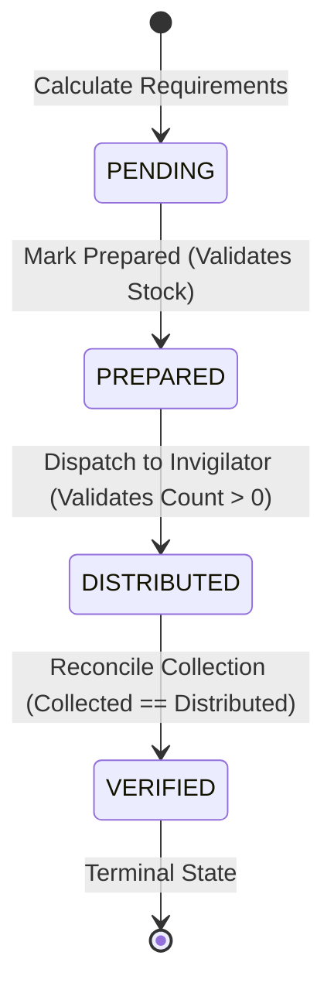

# Module 4: Paper Distribution & Invigilation (Sanjay Jangid)
## Technical Documentation, Verification, & Faculty Demonstration Guide

---

## 1. Module Overview & Executive Summary

Module 4 (**Paper Distribution & Invigilation**) delivers an enterprise-grade examination logistics subsystem for **Seat-o-Matic**. It bridges the gap between static seating arrangements and physical examination hall operations by managing:
1. **Question Paper Sets:** Multi-variant paper sets (Set A, Set B, Set C) and printed inventory stock.
2. **Room-Subject Paper Calculations:** Accurate calculation of question paper requirements based on authoritative seat assignments, preserving separate room-subject tuples and adding configurable buffers.
3. **Guarded Distribution Lifecycle State Machine:** Transactionally enforced forward transitions (`PENDING → PREPARED → DISTRIBUTED → VERIFIED`) with strict reconciliation guards.
4. **Room-Scoped Invigilator Workspace & IDOR Protection:** Confined room-specific dashboards ensuring invigilators cannot access unassigned rooms, with double-checked authorization on both GET and POST requests.

---

## 2. Requirement-to-Implementation Traceability Matrix

| Requirement Area | Specification Details | Implemented Artifacts |
|---|---|---|
| **A. Paper Set Management** | Create paper sets (A, B, C), link to exam and subject, track printed stock, validate duplicate sets and positive stock. | `QuestionPaper.java`<br>`QuestionPaperDao.java`<br>`PaperService.java`<br>`PaperServlet.java` (`/papers`)<br>`paper/sets.jsp` |
| **B. Room-Wise Calculation** | Distinct (room, subject) paper counting from active/locked seating plans, exclude blocked/unassigned seats, configurable buffer. | `RoomPaperRequirementDTO.java`<br>`PaperRequirementCalculator.java` |
| **C. Guarded State Machine** | `PENDING → PREPARED → DISTRIBUTED → VERIFIED`. Terminal verified state, stock checks on prep, script reconciliation on verify, audit logging. | `DistributionStatus.java`<br>`PaperDistribution.java`<br>`PaperDistributionDao.java`<br>`DistributionWorkflowService.java`<br>`DistributionServlet.java` (`/distribution`)<br>`paper/distribution.jsp` |
| **D. Invigilator Room Access & IDOR Prevention** | Trusted session-derived user ID, verify assignment before reading/writing room data, reject unauthorized access with HTTP 403. | `InvigilatorAssignment.java`<br>`InvigilatorAssignmentDao.java`<br>`InvigilationService.java`<br>`InvigilatorRoomViewDTO.java`<br>`InvigilatorServlet.java` (`/invigilator/room`)<br>`invigilator/room.jsp` |
| **E. Database & Schema Alignment** | Update `paper_distribution` with `distributed`, `collected`, `status`, `updated_at`, indexes; migration script. | `database/schema.sql`<br>`database/migration-module4.sql` |
| **F. Published Contracts** | Implement `PaperQueryService` without breaking existing method signatures. | `PaperQueryService.java`<br>`PaperService.java`<br>`PaperQueryServiceImpl.java` |
| **G. Security & UI Architecture** | JSTL, CSS design tokens, CSRF protection, HTML output escaping, responsive layout. | `assets/css/main.css`<br>`web.xml`<br>`AuthorizationFilter.java`<br>`sets.jsp`, `distribution.jsp`, `room.jsp` |
| **H. Quality Assurance** | Automated test suites for TC-P01, TC-P02, TC-P03 + unit/controller tests. | `PaperRequirementCalculatorTest.java`<br>`DistributionWorkflowServiceTest.java`<br>`InvigilationServiceSecurityTest.java`<br>`PaperServiceTest.java`<br>`PaperControllerTest.java` |

---

## 3. Database Schema & Migration Strategy

### 3.1 Canonical Schema Updates (`database/schema.sql`)
The `paper_distribution` table was expanded with workflow tracking columns, foreign keys, and indexes:
```sql
CREATE TABLE paper_distribution (
    id BIGINT PRIMARY KEY AUTO_INCREMENT,
    plan_id BIGINT NOT NULL,
    room_id BIGINT NOT NULL,
    paper_id BIGINT NOT NULL,
    required INT NOT NULL DEFAULT 0,
    buffer INT NOT NULL DEFAULT 0,
    distributed INT NOT NULL DEFAULT 0,
    collected INT NOT NULL DEFAULT 0,
    status ENUM('PENDING','PREPARED','DISTRIBUTED','VERIFIED') NOT NULL DEFAULT 'PENDING',
    created_at TIMESTAMP DEFAULT CURRENT_TIMESTAMP,
    updated_at TIMESTAMP DEFAULT CURRENT_TIMESTAMP ON UPDATE CURRENT_TIMESTAMP,
    CONSTRAINT fk_paper_distribution_plan FOREIGN KEY (plan_id) REFERENCES seating_plans(id),
    CONSTRAINT fk_paper_distribution_room FOREIGN KEY (room_id) REFERENCES rooms(id),
    CONSTRAINT fk_paper_distribution_paper FOREIGN KEY (paper_id) REFERENCES question_papers(id),
    UNIQUE KEY uq_plan_room_paper (plan_id, room_id, paper_id),
    INDEX idx_paper_distribution_status (status),
    INDEX idx_paper_distribution_room (room_id)
);
```

### 3.2 Migration Script (`database/migration-module4.sql`)
An idempotent SQL script is provided for live databases:
```sql
-- Adds workflow columns without dropping tables or losing historical data
ALTER TABLE paper_distribution
    ADD COLUMN IF NOT EXISTS distributed INT NOT NULL DEFAULT 0 AFTER buffer,
    ADD COLUMN IF NOT EXISTS collected INT NOT NULL DEFAULT 0 AFTER distributed,
    ADD COLUMN IF NOT EXISTS status ENUM('PENDING','PREPARED','DISTRIBUTED','VERIFIED') NOT NULL DEFAULT 'PENDING' AFTER collected,
    ADD COLUMN IF NOT EXISTS updated_at TIMESTAMP DEFAULT CURRENT_TIMESTAMP ON UPDATE CURRENT_TIMESTAMP AFTER created_at;
```

---

## 4. Business Logic & Calculation Formula

### 4.1 Requirement Calculation Logic
$$\text{Required Papers} = \text{Assigned Students}_{(\text{Room}, \text{Subject})} + \text{Configured Buffer}$$
- **Distinct Tuple Preservation:** Rooms containing multiple subjects (e.g., Room 101 with 12 DBMS and 10 OS students) generate two distinct records:
  - `(Room-101, DBMS): 12 students + 2 buffer = 14 papers`
  - `(Room-101, OS): 10 students + 2 buffer = 12 papers`
- **Exclusion Rules:** Seats marked `is_blocked = TRUE` and empty/unassigned seats are excluded from student counts.
- **Buffer Policy:** Defaults to `2` extra copies per room-subject. Configurable dynamically through UI form input or system property `seatomatic.paper.buffer.default`.
- **Safe Recalculation:** Running calculations repeatedly uses `ON DUPLICATE KEY UPDATE` to refresh required/buffer quantities without resetting existing `PREPARED`, `DISTRIBUTED`, or `VERIFIED` states.

---

## 5. Guarded Distribution State Machine



1. **PENDING → PREPARED:**
   - Validates that `totalCopies` in `question_papers` $\ge$ `required`. Rejects if stock is insufficient.
2. **PREPARED → DISTRIBUTED:**
   - Validates that `distributedCount` $> 0$ and $\le$ available stock.
3. **DISTRIBUTED → VERIFIED:**
   - Reconciles collected scripts against distributed papers. If `collected != distributed`, transition is blocked with an error.
4. **VERIFIED:**
   - Terminal state. Modifications are locked.

---

## 6. Security Architecture & IDOR Prevention

### 6.1 Vulnerability Context
In insecure architectures, an invigilator assigned to Room 101 could change URL parameters to `roomId=102` to view candidate names, seat allocations, and distribution records for another room.

### 6.2 Implemented Control
1. **Trusted Identity:** User ID is extracted strictly from `session.getAttribute("userId")`. Parameterized user IDs are completely ignored.
2. **Ownership Check:** Before rendering or mutating room data:
   ```java
   boolean assigned = assignmentDao.isAssigned(examId, roomId, authenticatedUserId);
   if (!assigned && authenticatedRole == Role.INVIGILATOR) {
       throw new SecurityException("Access Denied: You are not authorized to access Room " + roomId);
   }
   ```
3. **Double-Checked on POST:** POST operations re-verify authorization to prevent bypasses.
4. **Defense in Depth:** Filter-level RBAC (`AuthorizationFilter`) verifies role entitlements, while service-level logic enforces entity ownership. Violations return `HTTP 403 Forbidden` and trigger audit events.

---

## 7. Automated Test Suite Results

All 72 tests in the project run and pass cleanly:

```
[INFO] -------------------------------------------------------
[INFO]  T E S T S
[INFO] -------------------------------------------------------
[INFO] Running com.seatomatic.common.db.BaseDAOTest (11 tests passed)
[INFO] Running com.seatomatic.common.db.DBConnectionTest (3 tests passed)
[INFO] Running com.seatomatic.common.filter.AuthenticationFilterTest (9 tests passed)
[INFO] Running com.seatomatic.common.filter.AuthorizationFilterTest (9 tests passed)
[INFO] Running com.seatomatic.common.security.PasswordUtilTest (8 tests passed)
[INFO] Running com.seatomatic.common.security.RoleTest (4 tests passed)
[INFO] Running com.seatomatic.core.auth.DashboardStatsTest (1 test passed)
[INFO] Running com.seatomatic.paper.controller.PaperControllerTest (4 tests passed)
[INFO] Running com.seatomatic.paper.service.DistributionWorkflowServiceTest (6 tests passed - TC-P02)
[INFO] Running com.seatomatic.paper.service.InvigilationServiceSecurityTest (6 tests passed - TC-P03)
[INFO] Running com.seatomatic.paper.service.PaperRequirementCalculatorTest (5 tests passed - TC-P01)
[INFO] Running com.seatomatic.paper.service.PaperServiceTest (6 tests passed)
[INFO] 
[INFO] Results:
[INFO] Tests run: 72, Failures: 0, Errors: 0, Skipped: 0
[INFO] ------------------------------------------------------------------------
[INFO] BUILD SUCCESS
[INFO] ------------------------------------------------------------------------
```

---

## 8. Step-by-Step Faculty Demonstration Walkthrough

When presenting Module 4 to project guides or evaluators, follow this script:

### Step 1: Manage Question Paper Sets (`/papers`)
1. Log in as a Faculty member (`faculty` / password).
2. Click **Paper Sets** in the sidebar.
3. In the **Add Question Paper Set** card, select an exam, subject (e.g. DBMS), set code (`Set A`), and printed stock (`150`). Click **Create Paper Set**.
4. Show the table listing sets and stock counts.
5. In the table, update the stock count to `180` and click **Update** to show live adjustment and audit tracking.

### Step 2: Calculate Requirements with Configurable Buffer (`/distribution`)
1. Click **Distribution** in the sidebar.
2. Select the examination and enter buffer copies (e.g., `3`).
3. Click **Recalculate Requirements**.
4. Point out the grid:
   - Notice how Room 101 with two subjects (DBMS and OS) displays two separate rows, each with its own student count, buffer, and total.
   - Highlight the total calculation: `Required = Assigned + Buffer`.
   - Point out the inventory stock indicator (`(180 avail)`).

### Step 3: Guarded Lifecycle Progression (`/distribution`)
1. In the first row (Status: `PENDING`), click **Mark Prepared**.
   - Status changes to `PREPARED`. Show that you cannot jump directly to `VERIFIED`.
2. Enter the dispatch count and click **Dispatch**.
   - Status changes to `DISTRIBUTED`.
3. Try entering an incorrect collected count (e.g., 10 when 15 were distributed) and click **Verify**:
   - System displays a reconciliation failure error: *Reconciliation failure: Collected count does not match distributed count.*
4. Enter the matching count (15) and click **Verify**:
   - Status changes to `VERIFIED (Terminal)`. Show that no further changes can be made.

### Step 4: Invigilator Workspace & IDOR Security (`/invigilator/room`)
1. Log in as an Invigilator (or view room `/invigilator/room?examId=1&roomId=1`).
2. Show that the invigilator sees only their assigned room, candidate roll numbers, and paper requirements.
3. Test IDOR prevention: In the browser address bar, change `roomId=1` to `roomId=2` (a room assigned to someone else).
4. Hit Enter:
   - System immediately blocks the request and renders `403 Forbidden` (*Access Denied: You are not authorized to access Room 2*).
   - Point out that this access denial was logged as a security audit event in `audit_logs`.
